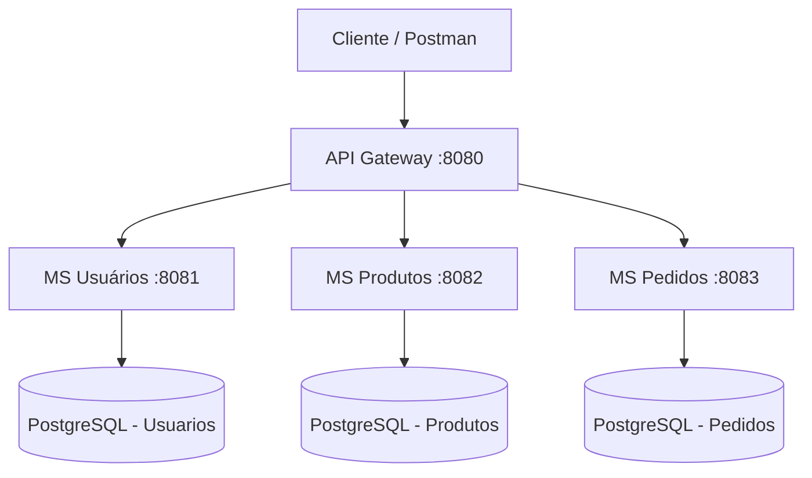

# 🛒 E-commerce com Arquitetura de Microsserviços

Projeto acadêmico desenvolvido para a disciplina de **Análise e Projeto de Software**, com o objetivo de aplicar os conceitos de arquitetura de microsserviços em um sistema de e-commerce.

A aplicação é dividida em serviços independentes, cada um responsável por um domínio específico do sistema. A comunicação externa é centralizada por meio de um **API Gateway**, enquanto cada microsserviço possui seu próprio banco de dados PostgreSQL.

## 📌 Arquitetura do projeto

O sistema é composto por quatro aplicações:

| Componente | Responsabilidade | Porta |
|---|---|---|
| API Gateway | Centralizar e encaminhar as requisições | 8080 |
| MS Usuários | Gerenciamento de usuários | 8081 |
| MS Produtos | Gerenciamento de produtos | 8082 |
| MS Pedidos | Gerenciamento de pedidos | 8083 |

### Visão geral da arquitetura



### Organização dos microsserviços

**1. MS Usuários (`ms-usuarios`)**

Responsável pelo gerenciamento dos usuários.

Funcionalidades:
- Cadastro de usuários.
- Listagem de usuários.
- Busca por ID.
- Atualização de dados.
- Exclusão de usuários.

**2. MS Produtos (`ms-produtos`)**

Responsável pelo gerenciamento do catálogo de produtos.

Funcionalidades:
- Cadastro de produtos.
- Listagem de produtos.
- Busca por ID.
- Atualização de produtos.
- Exclusão de produtos.

**3. MS Pedidos (`ms-pedidos`)**

Responsável pelo gerenciamento dos pedidos realizados no e-commerce.

Funcionalidades:
- Criação de pedidos.
- Listagem de pedidos.
- Busca de pedidos por ID.
- Exclusão de pedidos.
- Registro de usuário, produtos, data de criação e status do pedido.

**4. API Gateway (`api-gateway`)**

Atua como ponto único de entrada da aplicação.

É responsável por receber as requisições HTTP e encaminhá-las ao microsserviço correspondente, de acordo com o caminho solicitado.

Exemplo:

- `/usuarios/**` → MS Usuários.
- `/produtos/**` → MS Produtos.
- `/pedidos/**` → MS Pedidos.

Dessa forma, o cliente não precisa acessar diretamente cada microsserviço ou conhecer suas respectivas portas.

---

## 🛠️ Tecnologias utilizadas

| Tecnologia | Utilização |
|---|---|
| Java 21 | Linguagem de programação |
| Spring Boot 4.1.2 | Desenvolvimento dos microsserviços |
| Spring Web MVC | Construção das APIs REST |
| Spring Data JPA | Persistência e acesso aos dados |
| Hibernate | Mapeamento objeto-relacional |
| Spring Validation | Validação de dados |
| Spring Cloud Gateway | Roteamento das requisições |
| PostgreSQL 17 | Bancos de dados |
| Maven | Gerenciamento de dependências e build |
| Docker | Containerização das aplicações |
| Docker Compose | Orquestração dos containers |

---

## 📂 Estrutura do projeto

```text
ecommerce-microsservicos/
│
├── api-gateway/
│   ├── src/
│   ├── Dockerfile
│   └── pom.xml
│
├── ms-usuarios/
│   ├── src/
│   │   ├── main/
│   │   └── test/
│   ├── Dockerfile
│   └── pom.xml
│
├── ms-produtos/
│   ├── src/
│   │   ├── main/
│   │   └── test/
│   ├── Dockerfile
│   └── pom.xml
│
├── ms-pedidos/
│   ├── src/
│   │   ├── main/
│   │   └── test/
│   ├── Dockerfile
│   └── pom.xml
│
└── docker-compose.yml
```

Cada microsserviço possui sua própria estrutura Spring Boot, com separação entre controllers, services, repositories, models e DTOs.

---

## 🚀 Como executar o projeto

Existem duas maneiras de executar a aplicação:

- Utilizando Docker Compose (recomendado).
- Executando os microsserviços individualmente com Maven.

### 1. Pré-requisitos

Para executar o projeto utilizando Docker, é necessário ter instalado:

- [Git](https://git-scm.com/)
- [Docker Desktop](https://www.docker.com/products/docker-desktop/)

O Docker Desktop já disponibiliza o Docker Engine e o Docker Compose.

### 2. Clonar o repositório

Abra o terminal e execute:

```bash
git clone https://github.com/andrewgoncalvesabreu/ecommerce-microsservicos.git
```

Entre na pasta do projeto:

```bash
cd ecommerce-microsservicos
```

### 3. Executar com Docker Compose

Com o Docker Desktop aberto, execute na raiz do projeto:

```bash
docker compose up --build
```

Esse comando irá:

1. Criar três containers PostgreSQL.
2. Criar os bancos de dados de usuários, produtos e pedidos.
3. Construir as imagens dos quatro serviços Java.
4. Iniciar os microsserviços.
5. Iniciar o API Gateway.
6. Configurar a comunicação entre os containers.

O Docker Compose também utiliza verificações de saúde (`healthcheck`) nos bancos de dados para aguardar que estejam disponíveis antes de iniciar os respectivos microsserviços.

Após a inicialização, a aplicação estará disponível em:

```text
http://localhost:8080
```

**Importante:** na primeira execução, o Docker precisará baixar as imagens e construir os projetos, portanto o processo pode demorar alguns minutos.

### 4. Verificar os containers

Para visualizar os containers em execução:

```bash
docker compose ps
```

Para acompanhar os logs de todos os serviços:

```bash
docker compose logs -f
```

Para acompanhar os logs de um serviço específico:

```bash
docker compose logs -f ms-usuarios
```

Outros exemplos:

```bash
docker compose logs -f ms-produtos
docker compose logs -f ms-pedidos
docker compose logs -f api-gateway
```

### 5. Encerrar a aplicação

Para parar os containers:

```bash
docker compose down
```

Os dados dos bancos são armazenados em volumes Docker, portanto permanecem disponíveis mesmo após a parada dos containers.

Para apagar também os dados persistidos:

```bash
docker compose down -v
```

**Atenção:** o segundo comando remove os volumes e apaga os dados armazenados nos bancos.

---

## 🗄️ Bancos de dados

A aplicação utiliza três instâncias independentes de PostgreSQL, uma para cada microsserviço de negócio.

| Banco | Nome | Porta externa | Porta interna |
|---|---|---:|---:|
| Usuários | usuarios | 5433 | 5432 |
| Produtos | produtos | 5434 | 5432 |
| Pedidos | pedidos | 5435 | 5432 |

Configuração utilizada no ambiente Docker:

| Parâmetro | Valor |
|---|---|
| Usuário | postgres |
| Senha | postgres |
| SGBD | PostgreSQL 17 |

Cada banco possui seu próprio volume persistente:

- `pgdata-usuarios`
- `pgdata-produtos`
- `pgdata-pedidos`

O Hibernate está configurado com `ddl-auto: update`, permitindo atualizar automaticamente a estrutura das tabelas conforme as entidades da aplicação.

---

## 🔌 Endpoints da API

Todas as requisições podem ser realizadas através do API Gateway, utilizando a porta 8080.

**URL base:**

```text
http://localhost:8080
```

### Usuários

| Método | Endpoint | Descrição |
|---|---|---|
| POST | `/usuarios` | Cadastrar usuário |
| GET | `/usuarios` | Listar usuários |
| GET | `/usuarios/{id}` | Buscar usuário |
| PUT | `/usuarios/{id}` | Atualizar usuário |
| DELETE | `/usuarios/{id}` | Excluir usuário |

Exemplo de cadastro:

```http
POST http://localhost:8080/usuarios
Content-Type: application/json
```

```json
{
  "nome": "João Silva",
  "email": "joao@email.com",
  "senha": "123456",
  "endereco": "Brasília - DF"
}
```

### Produtos

| Método | Endpoint | Descrição |
|---|---|---|
| POST | `/produtos` | Cadastrar produto |
| GET | `/produtos` | Listar produtos |
| GET | `/produtos/{id}` | Buscar produto |
| PUT | `/produtos/{id}` | Atualizar produto |
| DELETE | `/produtos/{id}` | Excluir produto |

Exemplo de cadastro:

```http
POST http://localhost:8080/produtos
Content-Type: application/json
```

```json
{
  "nome": "Notebook",
  "descricao": "Notebook para uso geral",
  "preco": 3500.00,
  "estoque": 10
}
```

### Pedidos

| Método | Endpoint | Descrição |
|---|---|---|
| POST | `/pedidos` | Criar pedido |
| GET | `/pedidos` | Listar pedidos |
| GET | `/pedidos/{id}` | Buscar pedido |
| DELETE | `/pedidos/{id}` | Excluir pedido |

Exemplo de criação:

```http
POST http://localhost:8080/pedidos
Content-Type: application/json
```

```json
{
  "usuarioId": 1,
  "produtosIds": [1, 2]
}
```

Ao criar um pedido, o sistema registra automaticamente a data de criação e define o status inicial como `PENDENTE`.

---

## 🧪 Testando a aplicação

Recomenda-se utilizar ferramentas como:

- [Postman](https://www.postman.com/)
- [Insomnia](https://insomnia.rest/)
- [cURL](https://curl.se/)

Uma sequência simples para testar o funcionamento:

1. Cadastrar um usuário.
2. Cadastrar um ou mais produtos.
3. Criar um pedido utilizando o ID do usuário e os IDs dos produtos.
4. Consultar os pedidos cadastrados.
5. Atualizar ou excluir usuários e produtos.
6. Verificar se as requisições estão sendo encaminhadas corretamente pelo API Gateway.

---

## 💻 Executar sem Docker

Também é possível executar os serviços individualmente utilizando Maven.

**Pré-requisitos:**

- Java 21.
- PostgreSQL 17.
- Maven Wrapper disponível nos diretórios dos serviços.

Primeiramente, é necessário disponibilizar os três bancos PostgreSQL nas portas 5433, 5434 e 5435, com os nomes e credenciais apresentados na seção de bancos de dados.

Em seguida, abra um terminal para cada aplicação.

**MS Usuários:**

```bash
cd ms-usuarios
./mvnw spring-boot:run
```

No Windows:

```powershell
.\mvnw.cmd spring-boot:run
```

**MS Produtos:**

```bash
cd ms-produtos
./mvnw spring-boot:run
```

**MS Pedidos:**

```bash
cd ms-pedidos
./mvnw spring-boot:run
```

**API Gateway:**

```bash
cd api-gateway
./mvnw spring-boot:run
```

No Windows, utilize `.\mvnw.cmd spring-boot:run`.

Após iniciar todos os serviços, as requisições poderão ser realizadas através de `http://localhost:8080`.

---

## 🏗️ Conceitos de arquitetura aplicados

O projeto busca demonstrar conceitos importantes da arquitetura de microsserviços:

- **Separação de responsabilidades:** cada serviço possui um domínio específico.
- **Independência:** os microsserviços possuem aplicações e bancos de dados próprios.
- **API Gateway:** centraliza o acesso às APIs e realiza o roteamento das requisições.
- **Containerização:** cada aplicação é executada em seu próprio container Docker.
- **Orquestração:** Docker Compose coordena a inicialização e a comunicação dos serviços.
- **Persistência independente:** cada microsserviço gerencia seus próprios dados.

## 🎓 Contexto acadêmico

Projeto desenvolvido como atividade acadêmica da disciplina de **Análise e Projeto de Software**, com foco no estudo e na implementação prática de uma arquitetura baseada em microsserviços.

## 👨‍💻 Repositório

GitHub: https://github.com/andrewgoncalvesabreu/ecommerce-microsservicos

---

*Projeto desenvolvido para fins educacionais.*
